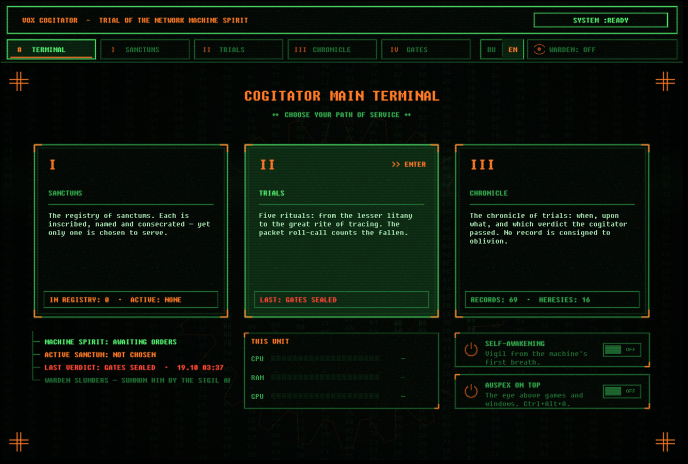

# Vox Cogitator

Network diagnostics for Windows with the soul of an old CRT terminal.



The cogitator finds where your connection breaks — your home network, your provider, a remote server or the path in between. Rituals test the link and pass a verdict, the sonar and the Auspex watch latency in the background, the Warden raises the alarm when the link falls, and the Chronicle keeps every verdict. It never changes your network settings — it only observes.

## Run

Download `Cogitator.exe` from [Releases](../../releases) and run it — no installation needed (Windows 10/11).
The file is unsigned, so SmartScreen may warn you: click "More info → Run anyway".

## Build

```
dotnet build -c Release -o out
```

## License

[MIT](LICENSE) © KeRR · fonts: [LICENSE-FONTS](assets/fonts/LICENSE-FONTS.md)
